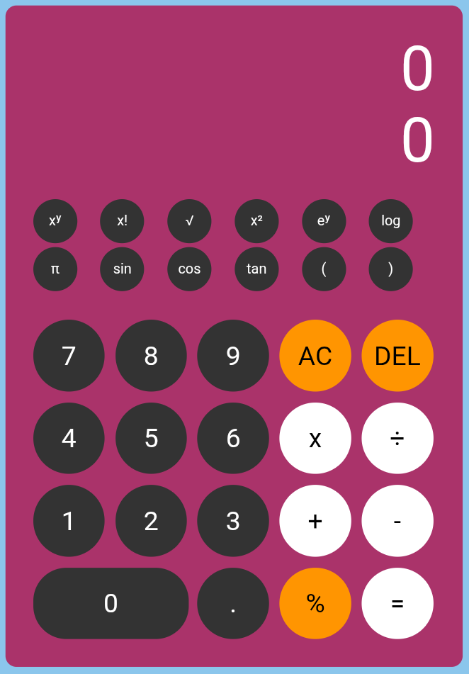

# Calculator App — Scientific Calculator

An interactive scientific calculator built with **HTML, CSS and JavaScript**. It combines everyday arithmetic with scientific functions in a colourful, easy-to-use interface. No frameworks or installation are required.

## Live demo

**[Open Calculator App](https://codeswithbux.github.io/Calculator-App/)**

## Preview



## How to run

Open the [live demo](https://codeswithbux.github.io/Calculator-App/) in your browser, or download the project and open **`index.html`** locally. The calculator runs directly in the browser.

## Folder structure

```text
Calculator-App/
├── index.html                Calculator layout and buttons
├── style.css                 Colours, layout and button styling
├── java.js                   Calculation logic and event handlers
├── assets/
│   └── calculator-preview.png  Cropped calculator screenshot
└── README.md                 Project documentation
```

## Features

- **Basic calculations** — addition, subtraction, multiplication and division.
- **Scientific functions** — powers, squares, square roots, factorials, exponential calculations and base-10 logarithms.
- **Trigonometry** — sine, cosine and tangent (using degrees).
- **Additional inputs** — π, percentages, decimal points and parentheses.
- **Clear and delete** — `AC` resets the calculation and `DEL` removes the last character.
- **Dual display** — displays the entered expression and the calculation result.
- **Error handling** — displays `Error` when an expression cannot be evaluated.
- **Direct interaction** — click or tap the calculator buttons without installing any software.

## How it works

The buttons are defined in `index.html` and styled in `style.css`. JavaScript in `java.js` listens for button clicks, builds the expression, converts scientific notation into JavaScript mathematical operations and displays the result when `=` is selected.

## Colours and styling

| Element | Style |
|---------|-------|
| Page background | Light blue (`rgb(139, 198, 236)`) |
| Calculator panel | Berry pink (`rgb(170, 51, 106)`) |
| Number and scientific buttons | Dark grey (`#333333`) |
| Action buttons (`AC`, `DEL`, `%`) | Orange (`rgb(255, 149, 1)`) |
| Arithmetic operator buttons | White |
| Display text | White |

## Technologies used

- **HTML5** for the calculator structure.
- **CSS3** for its layout and appearance.
- **JavaScript** for calculations, scientific functions and button interactions.

---

Built with HTML, CSS and JavaScript.
